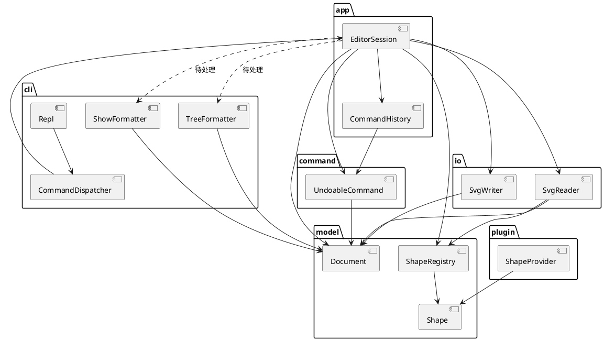

# SVG 编辑器（CLI）

## 架构方案

### 模块划分

| 目录            | 职责                                                    |
| ------------- | ----------------------------------------------------- |
| `src/cli`     | 进程入口、REPL、命令行分词、命令名分发、`help`，以及 `tree` / `show` 的文本格式 |
| `src/app`     | 编辑会话：当前文档、撤销栈、文档类命令之后的撤销锁                             |
| `src/command` | 一条用户命令一个类。编辑命令实现 `UndoableCommand`                    |
| `src/model`   | 画布、图形层次、按 id 索引、类型工厂。图形自己负责平移、缩放、属性、树文案和 SVG 片段       |
| `src/io`      | 把 SVG 文本读成 `Document`，以及把 `Document` 写成 SVG 文件        |
| `src/plugin`  | 后续图形插件的接口 `ShapeProvider`。本阶段不装载，`create box` 仍报未知类型  |

虚线是当前违反依赖规则的两条调用，见文末自查。

### 设计模式的选择

**Command。** 每次可撤销的编辑是一个对象：`execute` 改文档并留下恢复所需的状态，`undo` / `redo` 使用这份状态。`CommandHistory` 把成功的编辑压栈；返回值以 `error:` 开头的命令不入栈。`tree`、`show`、`help` 不入栈。`init`、`read`、`save` 和修改画布尺寸不入栈，并锁住撤销，直到下一次成功的编辑。

**Composite。** `Shape` 同时是叶子和容器的操作面：`translate`、`scale`、`trySetAttribute`，以及 `addChild` / `removeChild` / `insertChildAt`。`GroupShape.isComposite()` 为真，平移和缩放转给每个子节点；叶子的容器方法直接拒绝。`move`、`scale`、`delete`、`set` 因此只按 id 找到 `Shape`，不再按矩形、圆、组各写一套命令。

**两处按名字分派，标为待重构。**

1. 命令名 → 处理：`CommandDispatcher` 里的 `if (command === ...)`。注释已标「待重构」。
2. 类型名 → 类：`ShapeRegistry.createFromCliTokens` 与 `createFromSvgTag`。这是图形工厂，创建 CLI 图形和读入 SVG 元素都走这里。

这两处集中，是为了本阶段能把六种内置类型写完。新增命令或图形类型仍要改这两个类，所以不把它们算作已经插件化。

### 依赖方向规则

依赖只能从上往下。上面的模块了解用户怎么说，下面的模块只了解图形是什么。

| 允许                                      | 理由                             |
| --------------------------------------- | ------------------------------ |
| `cli` → `app`                           | 界面把一行命令交给会话，不自己改文档             |
| `app` → `command`、`model`、`io`、`plugin` | 会话选择命令、持有文档，并调用读写              |
| `command` → `model`、`plugin`            | 命令只通过文档和图形接口改状态                |
| `io` → `model`                          | 读写器把文件和 `Document` 互转，不了解 REPL |
| `plugin` → `model`                      | 插件要交出一棵 `Shape`                |

禁止 `model` 依赖 `cli`、`app`、`command`、`io`；禁止 `command` 和 `io` 依赖 `cli`。这样换掉命令行之后，文档和撤销语义还能留下。

违反上表的 import 是待处理项，不在这里改口放行。

### 变化点假设

1. **再增加一种图形，尤其是带标题的** `box`**。** 最可能变。留给以后的是 `Shape` 上的统一操作，以及 `ShapeProvider` 这个空接口。本阶段故意不把插件接进 `ShapeRegistry`：作业要求 `create box` 报 `unknown shape type`，内核现在就认识 `box` 会直接违反阶段边界。类型名分派因此仍标为待重构。
2. **再增加命令。** `CommandDispatcher` 会继续加分支。留了 `EditorCommand` / `UndoableCommand`，新编辑命令可以自己入栈；分发本身没有改成注册表。
3. **图形界面。** 模型不打印提示符，也不读标准输入。没有为 GUI 再做一层视图模型：本阶段只有一种界面，树和图是 CLI 的排版。真正换界面时，要先拆掉下面自查里的 `app` → `cli` 依赖。
4. **SVG 里更多属性或未知标签。** `fill` / `stroke` / `stroke-width` 收在 `PresentationStyle`，六种图形共用。几何属性仍在各个子类里，因为矩形的 `width` 和圆的 `r` 不是同一组字段。读入时不认识的标签直接跳过，不建立通用 XML 树。本阶段文件只需要这六种元素，通用 DOM 会把「保持兄弟顺序」和「嵌套组」两件已经出过错的事再做一遍。

## 过程记录

实现按 `doc/plans` 的阶段推进，命令先有测试再补行为。对照作业做了两次审查，下面是改过方向的几处。

**图形一度是公共数据袋。** 坐标是 `public` 字段，平移、缩放、类型名写在 `ShapeTransform` 的自由函数里，用一串 `instanceof` 区分矩形、圆和组。树、明细和 SVG 写出各有一份同样的分支。这和 2.1 禁止的写法一致。纠正方式是把这些操作做成 `Shape` 的方法，组只负责转给子节点；按名字创建图形只留在 `ShapeRegistry`。

**撤销锁被测试写成了和规格相反的行为。** `read` 之后再执行一次 `create`，测试仍断言 `undo` 被禁止。规格是：文档类命令之后先禁止撤销，下一次编辑重新允许。实现里 `ioLockedAfterRead` 一旦为真就不再清除，和这条测试互相咬住。测试改成「刚读入时禁止，下一次编辑之后允许」，会话按这个语义解锁。

**读入顺序错了两次。** 第一次按标签名收集子节点，`other.svg` 的根顺序变成 rect、circle、ellipse、text、g，而第 6 节要求 rect、text、circle、g、ellipse。改成按原文切片段之后，结束标签用的是第一个 `</g>`。用第 6.1 节的两层组试读，`node1` 消失，`arrow1` 被提到画布根上。`SvgSnippetParser` 改为按同名开始/结束标签配对，嵌套组的测试锁住 `flowchart` → `node1` → `start` 这条链。

`set` **的白名单和保存不一致。** 命令能改 rect 的 `stroke`、line 的 `stroke-width`，但 `show` 和写出的 SVG 都丢掉它们；text 不能设 `fill`，rect 不能设 `stroke-width`。测试原先只检查 line 的回显字符串。补上公共外观属性之后，同一条测试同时检查 `show` 和 `SvgWriter` 的文本。

**编组撤销和删除容器曾经是空的。** `group` / `ungroup` / `addto` 的 `undo` 固定返回 `nothing to undo`。删除组再撤销时，组回来了，子孙不在 id 索引里。这三项都补了快照，并用测试检查撤销后的父子关系和 `findById`。

## 一致性自查

**模块划分。** 与本节方案一致。和早期计划 `doc/plans/lab1_00_总览与架构.md` 有两处修订，都已经反映在上表里：读写目录由计划中的 `src/svg` 定为 `src/io`；`CommandHistory` 放在 `app`，因为它是会话的栈，不是一条命令。

**依赖方向。** `model`、`command`、`io` 没有依赖 `cli`。抽样如下。

- `src/model/Document.ts` 只引用 `Shape`。
- `src/command/MoveShapeCommand.ts` 只引用 `DocumentStore` 和命令接口。
- `src/io/SvgWriter.ts` 只引用 `Document`，写出时调用 `Shape.serializeSvg`。

有三处不符合上表，都是待处理项：

| 位置                                            | 实际依赖                                    | 问题                           |
| --------------------------------------------- | --------------------------------------- | ---------------------------- |
| `src/app/EditorSession.ts`                    | `cli/TreeFormatter`、`cli/ShowFormatter` | `app` 依赖 `cli`，方向反了          |
| `src/cli/TreeFormatter.ts`、`ShowFormatter.ts` | `model/Document`、`Shape`                | `cli` 越过 `app` 直接读模型         |
| `src/cli/CommandDispatcher.ts`                | `command/CommandMessages`               | `cli` 越过 `app` 直接引用命令模块的错误文案 |

前两处是一件事：会话自己把文档格式化成 CLI 文本。第三处只为一句 `error: invalid arguments`。

## 质量保证手段

功能是否完整，以规格里的命令、错误句和第 6 节会话为准，而不是只看类能否构造。

- 自动化测试：`npm test`（Node 内置测试，151 项通过）。覆盖六种 `create`、`in`、编组与撤销、删除容器后子孙仍能按 id 找到、`tree <id>`、`other.svg` 的根顺序、嵌套 `<g>`、`set` 白名单在 `show` 和 SVG 中的结果、`read` 之后下一次编辑重新允许撤销。
- 类型检查：`npm run typecheck` 通过。
- `Repl` 的标准输入循环没有自动化测试，命令语义由 `CommandDispatcher` 和 `EditorSession` 的测试覆盖。
- `box` 没有实现测试之外的行为；现有测试只确认它不在内置类型表中。

